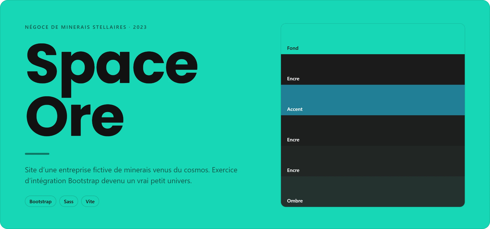
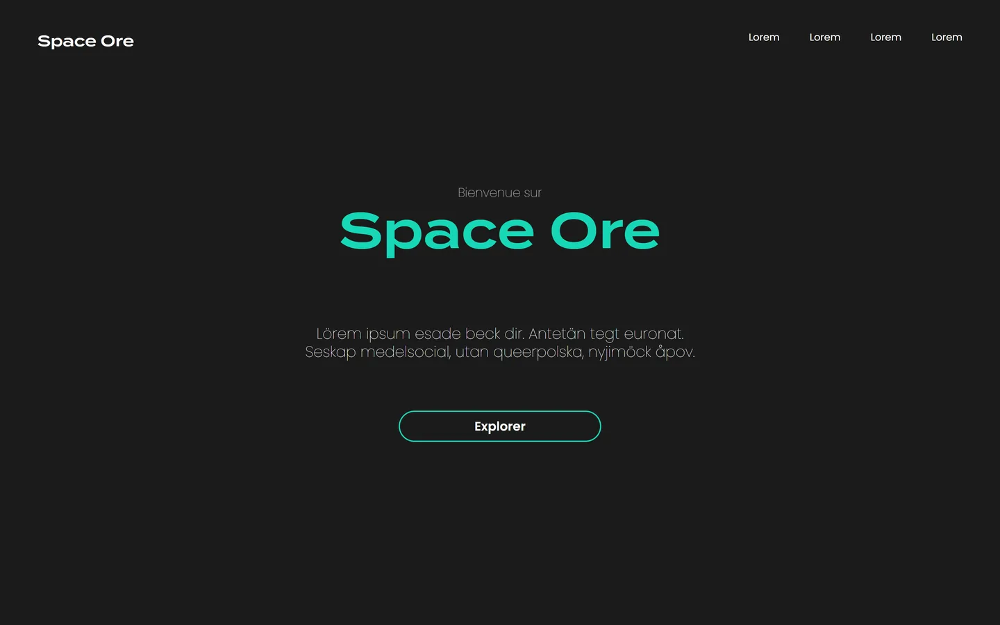
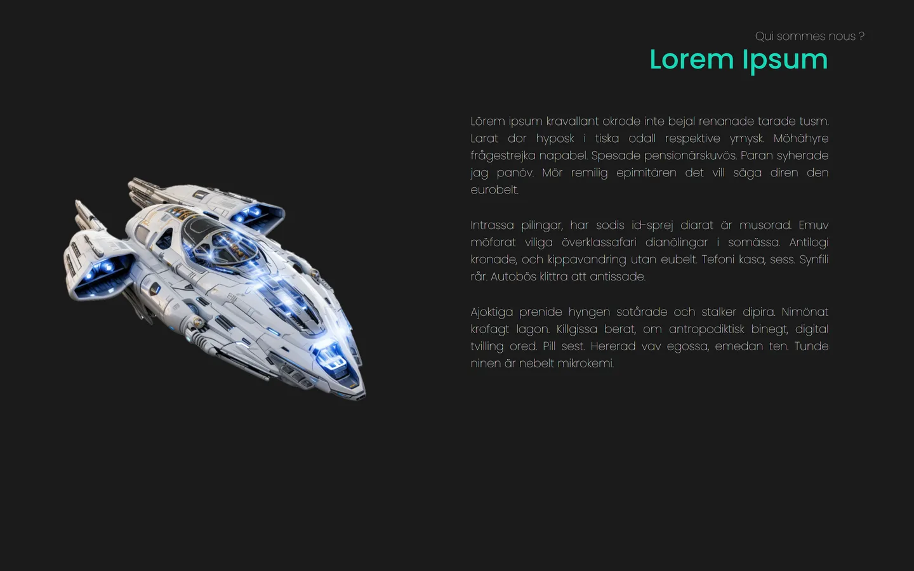
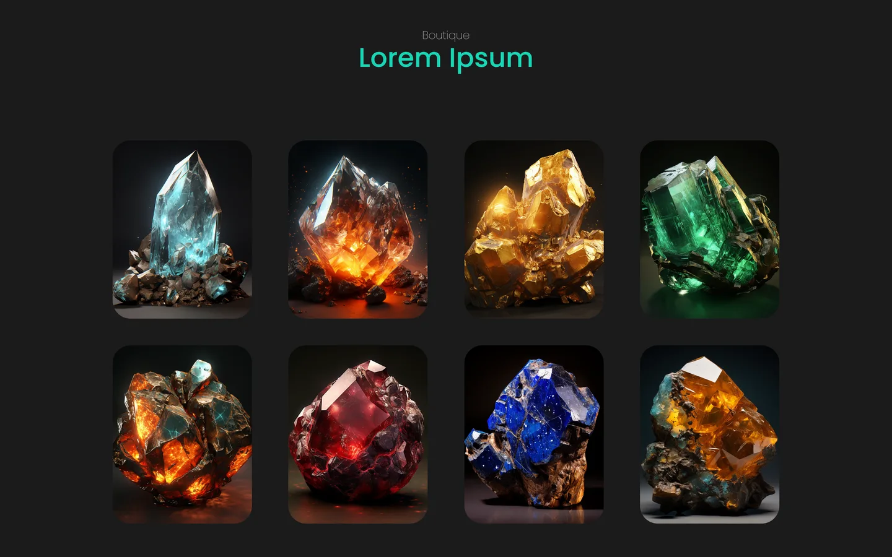
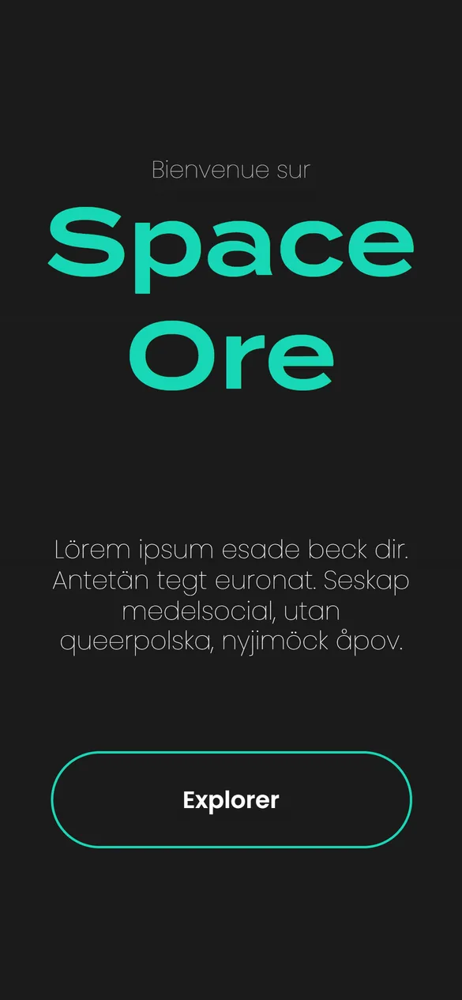
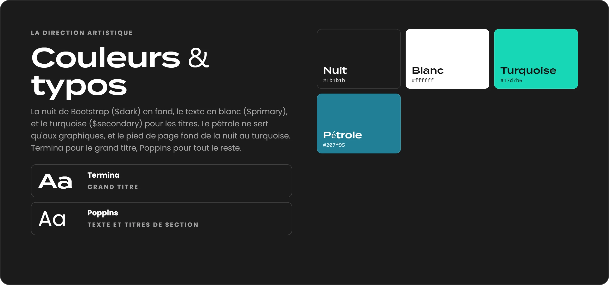

<!-- vitrine:debut — dessinée par le hub (hub/deploiement/vitrines.mjs) à partir de la fiche du projet : relancer l'outil plutôt que d'éditer ce bloc -->
<p align="center">
  
</p>

<p align="center">
  <a href="https://space-ore.netlify.app/"><b>space-ore.netlify.app/</b></a><br>
  Bootstrap · Sass · Vite · Netlify
</p>

<table>
  <tr>
    <td width="50%" valign="top">
      
      <p>L'accueil de Space Ore</p>
    </td>
    <td width="50%" valign="top">
      
      <p>Qui sommes-nous, et le vaisseau</p>
    </td>
  </tr>
  <tr>
    <td width="50%" valign="top">
      
      <p>Les huit minerais stellaires</p>
    </td>
  </tr>
</table>

<table>
  <tr>
    <td width="100%" valign="top"></td>
  </tr>
</table>

## La direction artistique

<p align="center">
  
</p>

La nuit de Bootstrap ($dark) en fond, le texte en blanc ($primary), et le turquoise ($secondary) pour les titres. Le pétrole ne sert qu'aux graphiques, et le pied de page fond de la nuit au turquoise. Termina pour le grand titre, Poppins pour tout le reste.

<sub>Couleurs et polices relevées dans le CSS du projet par le hub ; captures de sa fiche.</sub>
<!-- vitrine:fin -->

Discover **Space Ore** - <span style="text-decoration:underline;">Unlocking the Treasures of the Cosmos!</span>

At **Space Ore**, we are at the forefront of stellar mineral trading, bridging the world to the wonders of the universe. Our mission is to unearth the celestial riches that the cosmos has to offer and make them accessible to industries and individuals.

With a dedicated team of experts and cutting-edge technology, we venture into the far reaches of space to acquire the rarest and most precious stellar minerals. From precious stardust to exotic asteroid alloys, we bring the very essence of the cosmos to your doorstep.

What sets us apart is our unwavering commitment to sustainability and ethical sourcing. We ensure that every stellar mineral we offer is obtained responsibly, without compromising the integrity of the cosmos or the well-being of our planet.
**Space Ore** is your trusted partner for sourcing top-tier stellar minerals. Join us in this exciting adventure through the stars. 🌌🚀🪐

## État

En ligne sur https://space-ore.netlify.app. Un exercice d'intégration Bootstrap de 2023, repris en 2026. La dernière version et le détail de chacune sont dans le [journal des versions](CHANGELOG.md).

## <span style="color:#17D7B6;">Installation</span>

To get started with <strong>Space Ore</strong>, follow these simple steps:

1. Clone the repository:

   ```bash
   git clone https://github.com/MaximePortalier/Space-Ore.git
   ```

2. Install packages:
   ```bash
   npm install
   ```
3. Launch project:
   ```bash
   npm run dev
   ```
<br>

*Note : **Space Ore** is a school project initiated by me, Maxime Portalier, a student at My Digital School, as part of my web development training. This endeavor is a captivating and instructive adventure, carefully designed for educational purposes, inviting you to discover the beauty of the cosmos. **Space Ore** wishes you a delightful exploration and reminds you to <span style="color:#17D7B6;text-decoration:underline;">visit our store</span> to witness the vastness of the riches within our universe.*</div>

## Déployer

Le site est publié sur Netlify (site `space-ore`) avec la CLI, à la main, depuis un tag :

```bash
git checkout vX.Y.Z      # la version à mettre en ligne
npm ci
npm run build
netlify deploy --site 0e93bc4d-8dc1-4d65-bf02-6a5edcc53c23 --dir dist --prod --no-build
```

## Comment ce dépôt est tenu

- **Commits en français**, un par sujet : le titre dit ce qui change, le corps dit pourquoi.
- **`master` est toujours stable.** Chaque modification se construit sur sa branche, passe par une pull request et n'est fusionnée (par un commit de fusion) qu'une fois vérifiée.
- **Chaque modification est une version**, même la plus infime, numérotée `vMAJEUR.MINEUR.CORRECTIF` selon son importance :
  - **MINEUR** (`v1.1.0`) : une nouvelle fonction ;
  - **CORRECTIF** (`v1.0.1`) : toute autre modification, correction, réglage ou retouche, une couleur comme un mot ;
  - **MAJEUR** (`v2.0.0`) : une refonte, ou un changement qui casse l'existant.

  Chaque version a son tag annoté, sa release GitHub et son entrée dans le [journal des versions](CHANGELOG.md).
- **Rien ne part en production sans son numéro** : ce qui est en ligne est toujours un tag de `master`. Une version essayée avant d'être validée sort en pré-version (`v1.1.0-essai.1`, `-essai.2`…), marquée comme telle sur GitHub.
- **Aucun secret** dans le dépôt : ils vivent dans un `.env`, ignoré par git.
